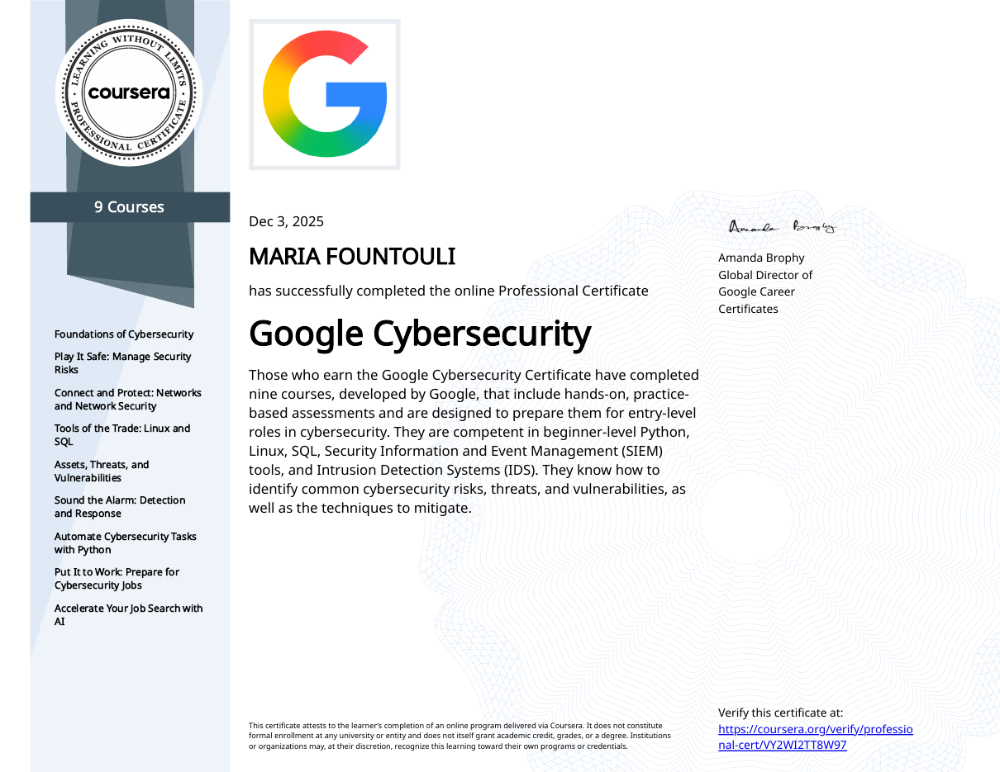

# Google Cybersecurity Professional Certificate: Portfolio

Completed in **December 2025**. Verify the certificate on [Coursera](https://coursera.org/verify/professional-cert/VY2WI2TT8W97) or see the [PDF](certificate/Google-Cybersecurity-Certificate-Maria-Fountouli.pdf).

Hands on work I completed during the [Google Cybersecurity Professional Certificate](https://www.coursera.org/professional-certificates/google-cybersecurity) (Coursera). Each folder contains one activity: the scenario, my analysis, and the original file I submitted.

**Maria Fountouli** · Applied Informatics graduate, MSc student in Next Generation Systems and Networks (University of Macedonia) · [LinkedIn](https://linkedin.com/in/maria-fountouli)

## Projects

| # | Project | Topics |
|---|---|---|
| 01 | [Security audit: Botium Toys](01-security-audit-botium-toys/) | NIST CSF, controls, PCI DSS, GDPR, SOC 2 |
| 02 | [Incident report: TCP SYN flood](02-syn-flood-incident-report/) | TCP handshake, DoS, log analysis |
| 03 | [Network traffic analysis: DNS and ICMP](03-dns-icmp-traffic-analysis/) | tcpdump, DNS, UDP, ICMP |
| 04 | [NIST CSF applied to a DDoS incident](04-nist-csf-ddos-incident/) | NIST CSF, ICMP flood, IDS/IPS |
| 05 | [Risk assessment: network hardening](05-network-hardening-risk-assessment/) | MFA, password policy, firewalls |
| 06 | [Incident report: brute force and malicious redirect](06-brute-force-incident-report/) | DNS/HTTP analysis, brute force, 2FA |
| 07 | [SOC alert ticket: phishing](07-phishing-alert-ticket/) | Alert triage, phishing playbook, escalation |
| 08 | [Threat intelligence: VirusTotal](08-threat-intel-virustotal/) | IoCs, Pyramid of Pain, VirusTotal |

## Course notes
My summarized study notes for all eight courses are in [`notes/`](notes/).

## Tools and skills covered
Splunk, Chronicle, Suricata, tcpdump, Wireshark, VirusTotal, Linux (Bash), SQL, Python, NIST CSF, incident response, threat modeling, risk assessment.
